# JapanDino

I work on ML tools and desktop apps.

A few things I've been working on:

- [Bloom RAG Studio](https://github.com/JapanDino/RAG-tool) — a tool for exploring learning materials through Bloom's taxonomy, a knowledge graph, and chat with sources.
- [Dinox Desktop](https://github.com/JapanDino/Dinox-Desktop) — a dock, calendar, search, and widgets for Windows. An early community release built on Bloom by sehaz.
- [Avatry](https://github.com/JapanDino/Avatry) — a virtual fitting-room prototype with measurement-based 3D avatars and garment-fit visualization.
- [AutoVibe Gym](https://github.com/skazhutin/autovibe-gym) — I contribute to the environment for evaluating ML agents, including experiment orchestration and verification tooling.

There's also [Dinox Calendar](https://github.com/JapanDino/Dinox), a separate local-first calendar project, and [Agro-checker](https://github.com/JapanDino/Agro-checker), our team's research into agricultural-risk warnings.
